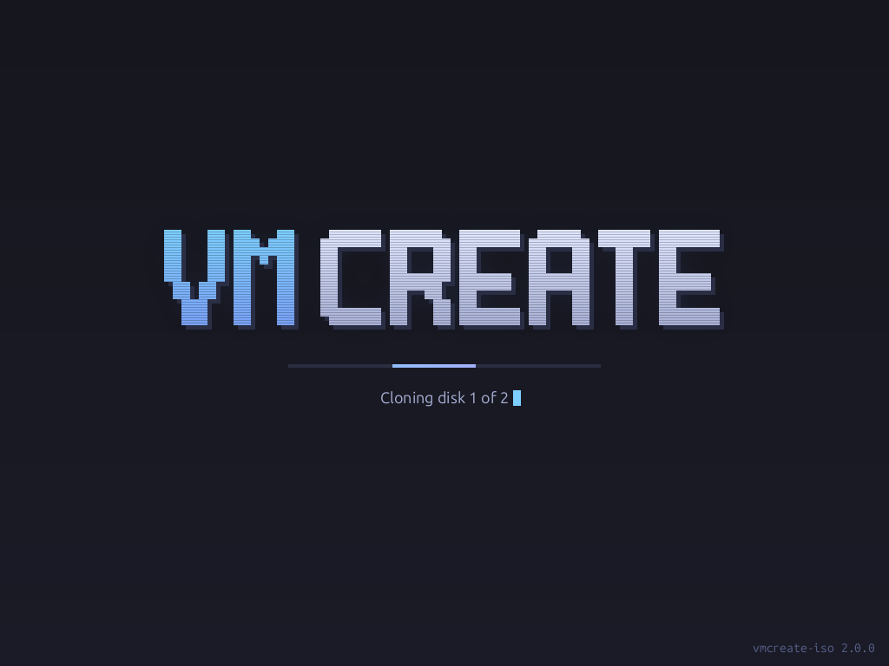

# vmcreate-iso

Boot medium for [VMCreate](https://github.com/moerketh/VMCreate) deployments.

## What it is

A minimal, **logic-free** live ISO. It boots the VM and offers exactly two
things:

- **sshd over Hyper-V vsock** (socket-activated, `sshd -i` per connection,
  port 22) — the host connects with
  `ssh -o ProxyCommand="hvc.exe nc -t vsock <vm-guid> 22"`; no NIC, no IP
  discovery, no DHCP dependency for the control channel
- **baked disk tools** (partclone, lvm2, btrfs-progs, gdisk, rsync, …) that
  VMCreate drives remotely

All deployment logic lives in VMCreate and is pushed per deploy. The only
guest-side bootstrap is the SSH **public key**, delivered via host→guest KVP
(`VMCREATE_SSH_PUBKEY`) and installed by `autorun/inject_ssh_key.sh` using a
first-NUL reader (see `lib/functions.sh` — stale heap bytes behind the
terminator are a documented hv_kvp_daemon behavior).

Kernel: `linux-virtual` (virtio + Hyper-V + VMware drivers — boots on Hyper-V
Gen 2 and under QEMU/KVM with OVMF + Secure Boot). UEFI + Secure Boot
(Microsoft-signed shim/grub chain); no BIOS boot. SSH user: `vmcreate`
(key-only, passwordless sudo), matching VMCreate's default.

## Splash screen



A Plymouth theme shows from the initramfs until power-off (the GRUB menu is
hidden; hold Esc/Shift for it, including a verbose no-splash entry; Esc on
the splash shows the console log). The ISO only ships the theme — VMCreate
drives the text over SSH with stock plymouth commands:

```bash
sudo plymouth display-message --text="Cloning disk 1 of 2"
sudo plymouth system-update --progress=42   # 1..100: determinate bar
sudo plymouth system-update --progress=0    # back to the indeterminate sweep
```

Typing at the console is an easter egg: any key cycles the splash through
normal → letters flip upside down → red palette → letter rain, and printable
characters tumble off the status line. Plymouth exposes keyboard input only
(no pointer events), so the mouse cursor in the VM window is inert; Esc
keeps toggling the console log. Host-driven messages and progress work in
every state.

The graphics are generated, not drawn: `python3 splash/render.py --preview`
(Pillow) rewrites `splash/vmcreate/*.png` and the preview above. Plymouth
renders on the built-in simpledrm (`drivers/gpu` is stripped), hence
`plymouth.use-simpledrm` on the kernel command line.

## Build

From a native Linux filesystem (WSL: copy out of /mnt/c first), on an
**Ubuntu host**: the EFI boot image embeds the host's signed grub/shim, and
Ubuntu's signed GRUB searches for `/EFI/ubuntu/grub.cfg` — a Debian host
builds fine but lands on a `grub>` prompt at boot (build.sh fails fast on
this). CI pins `ubuntu-24.04` for the same reason.

```bash
sudo apt-get install -y debootstrap squashfs-tools xorriso grub-efi-amd64-bin \
    grub-efi-amd64-signed shim-signed mtools dosfstools
./build.sh
```

Releases are tagged `v*`; CI builds, tests (bats) and publishes the ISO
to the GitHub release. VMCreate downloads the newest stable release (a
prerelease only while no stable one exists) and replaces its cached copy
when the version differs.

## Release signing

Every release carries a signed manifest; VMCreate only boots an ISO whose
manifest verifies against a public key it ships with.

```
vmcreate-2.1.0.iso
vmcreate-2.1.0.iso.sha256           # integrity only (same origin as the ISO)
vmcreate-2.1.0.manifest.json        # version, tag, commit, ISO size + sha256, key_id
vmcreate-2.1.0.manifest.json.sig    # ECDSA P-256 / SHA-256, DER, over the exact manifest bytes
```

`key_id` is the first 16 hex of `sha256(DER SubjectPublicKeyInfo)`; the
trusted public keys live in `keys/<key_id>.pub.pem` — the signing key and
an offline backup, so a lost or leaked signing key can be replaced without
breaking existing VMCreate installs. The private signing key exists only as
the `ISO_SIGNING_KEY` secret of the `release` environment (maintainer
approval, `v*` tags only; a tag ruleset lets only the maintainer create
`v*` tags). In CI, `build` holds no write token and never sees the key;
`sign-release` checks out only `release/` and `keys/`, signs the build's
artifact and verifies the result before publishing.

Verify a downloaded release by hand (openssl + coreutils only):

```bash
release/verify.sh vmcreate-2.1.0.manifest.json vmcreate-2.1.0.manifest.json.sig vmcreate-2.1.0.iso
```

## Layout

```
build.sh          debootstrap → chroot → squashfs → ISO
chroot_setup.sh   runs inside the chroot: kernel, sshd, vsock socket units
guest/            systemd units + tmpfiles, first-class so CI verifies them
initramfs/        initramfs hook trimming xfs/btrfs/iscsi modules from the
                  initrd (they stay in the rootfs for target deployments)
splash/           Plymouth theme (vmcreate/) + render.py that generates it
autorun/          inject_ssh_key.sh — the only boot-time logic
lib/functions.sh  log + read_kvp_field (first-NUL KVP reader)
release/          make-manifest.sh (CI signing) + verify.sh (VMCreate's checks)
keys/             trusted release-signing public keys, named by key_id
test/             bats: reader tests, inject_ssh_key tests (real script,
                  test hooks), guest unit and splash assertions; CI also runs
                  systemd-analyze verify on guest/
```
